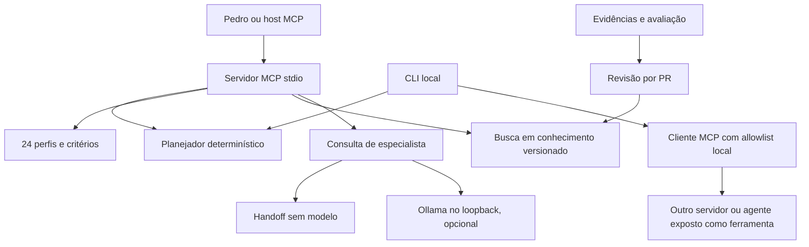

# Arquitetura inicial

## Decisão

Usar um monólito modular em TypeScript sobre Node.js 24 LTS. O Sofiie existente usa TypeScript, Fastify e Tauri; o novo repositório compartilha a linguagem sem importar segredos, permissões ou código do produto. Esta é uma ferramenta de engenharia separada do assistente de produção.

O caminho evidências → PR → conhecimento é um processo de contribuição manual. Não existe autopromoção de memória. O diagrama não representa integração já feita com o Sofiie.

## Ferramentas e tecnologias

| Componente             | Escolha                                           | Motivo e limite                                                                   |
| ---------------------- | ------------------------------------------------- | --------------------------------------------------------------------------------- |
| Linguagem/runtime      | TypeScript estrito, Node.js 24                    | Contratos claros, afinidade com o produto e execução no Windows/Linux             |
| Protocolo              | SDK oficial MCP TypeScript v2, stdio              | Evita implementar JSON-RPC manualmente e não exige servidor hospedado             |
| Validação              | Zod                                               | Rejeita dados inválidos e campos desconhecidos nas ferramentas                    |
| Testes                 | node:test, tsx                                    | Poucas dependências e testes de processo real                                     |
| Modelo                 | Ollama local opcional                             | Sem API paga; disponibilidade e desempenho dependem da máquina                    |
| Conhecimento inicial   | JSON versionado com fontes e status               | Revisável por Git, sem banco vetorial obrigatório                                 |
| Persistência futura    | SQLite                                            | Adicionar quando houver runs, avaliações e retenção reais; ainda não implementado |
| Avaliação de UI futura | Playwright e axe-core                             | Automação não substitui teclado e leitor de tela                                  |
| CI                     | GitHub Actions, runner Ubuntu padrão público      | Sem inferência, agendamento, artifacts, caches ou credenciais de serviços         |
| Python                 | Somente para experimentos futuros de avaliação/ML | Não duplicar runtime agora sem necessidade comprovada                             |

Não há framework multiagente adicional. As responsabilidades atuais cabem em módulos pequenos. LangGraph, filas, containers, embeddings e fine-tuning precisam demonstrar benefício antes de entrar no projeto.

## Fronteiras e contratos

- `planTask`: entrada validada → plano com `executed: false`. Os revisores são funções sugeridas, não agentes iniciados.
- `consultSpecialist`: entrada validada → `handoff` sem inferência ou `generated` com proposta local não confiável. Nunca afirma implementação.
- `searchKnowledge`: texto de consulta → até cinco entradas com fontes. Não recebe caminho de arquivo e não grava conhecimento.
- `callPeerTool`: configuração local validada e ferramenta permitida → resultado marcado `trusted: false`. Sem escolha de executável por entrada MCP.
- A CLI pode iniciar um peer aprovado na configuração local. O servidor MCP não oferece ferramenta de shell, escrita, instalação ou chamada livre de peers.

## Restrições reais

O planejador usa correspondência de palavras em português/inglês. Pode errar em tarefas ambíguas; a seleção explícita está disponível pela API MCP. Perfis não são processos isolados e não têm memória própria.

O adaptador de IA não fornece ferramentas ao modelo. Instruções de prompt ajudam na análise, mas não constituem controle de segurança. As fronteiras efetivas desta versão são a ausência de execução de ações pelo modelo, schemas fechados, ausência de escrita de repositórios e configuração local de peers.

Executar um peer é executar um programa com as permissões do seu usuário. A allowlist limita as chamadas feitas pelo cliente, mas não restringe os efeitos internos desse programa. Uma futura camada de ferramentas com escrita precisará de isolamento, política de risco e revisão própria.

## Integração com Sofiie

O produto atual mantém contratos e políticas existentes. O piloto deve começar com uma issue real, sem segredos, enviar somente contexto necessário ao perfil, comparar resultado com critérios de aceite e abrir PR no produto. Importar este código ou liberar ferramentas de automação no Tauri não faz parte do bootstrap.

## Decisões registradas

1. Especialistas compartilham runtime e podem compartilhar um modelo; não há razão comprovada para treinar pesos separados.
2. Inferência é opcional, local e sem fallback para nuvem.
3. MCP stdio primeiro; HTTP autenticado e A2A depois de evidência de necessidade.
4. Referências de projeto e lições aprovadas são categorias separadas. Acúmulo de arquivos não é medida de aprendizado.
5. Inicialização publica somente código e documentação públicos. Nenhum material pessoal ou arquivo de memória privada é copiado.
